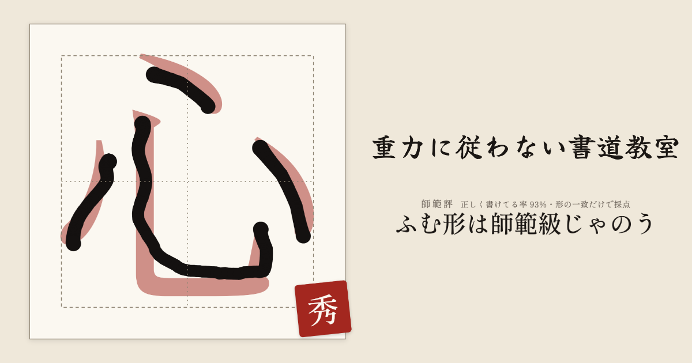
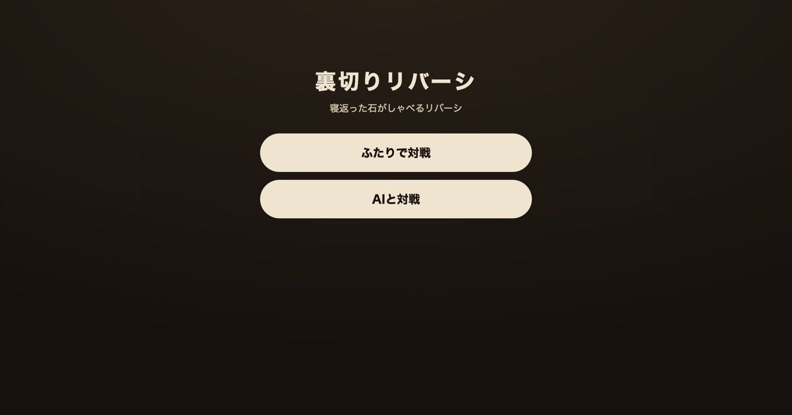
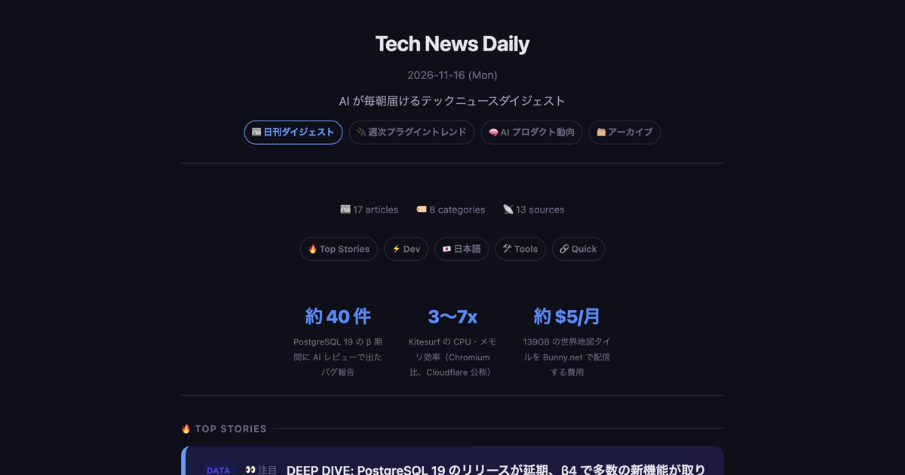
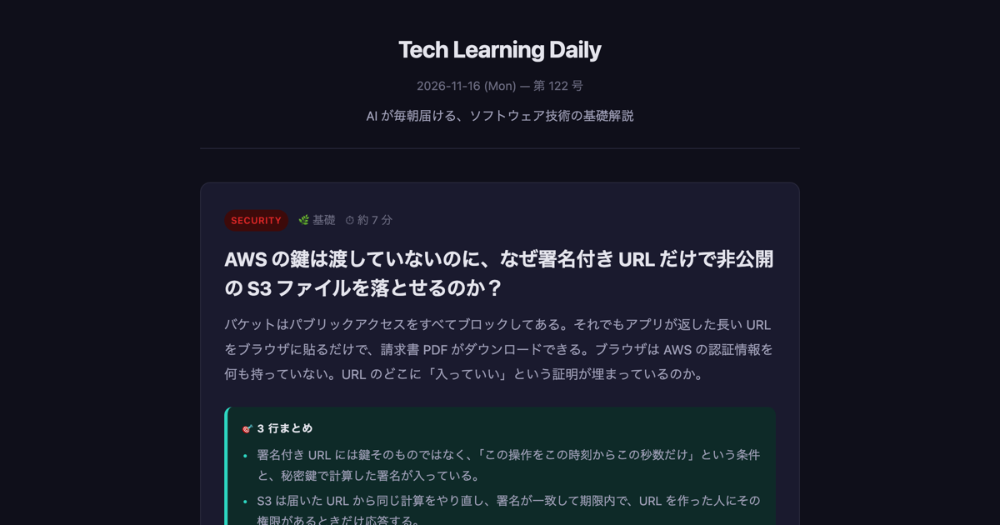

<picture>
  <source media="(prefers-color-scheme: dark)" srcset="https://readme-typing-svg.herokuapp.com?font=Fira+Code&weight=600&size=28&duration=3000&pause=1000&color=BD93F9&center=true&vCenter=true&random=false&width=700&lines=%F0%9F%91%8B+Hi%2C+I%27m+kaion%3B%E3%83%95%E3%83%AB%E3%82%B9%E3%82%BF%E3%83%83%E3%82%AF%E3%82%A8%E3%83%B3%E3%82%B8%E3%83%8B%E3%82%A2%3BFrom+API+to+UI+to+AWS" />
  
</picture>

  
  
  

---

## 👤 About Me

フルスタックエンジニアです。API と業務ロジックから画面、Terraform で組む AWS の基盤まで、ひとつの機能を端から端まで作ります。いまは業務システムの申請・承認基盤で、Go / gRPC、Rails API、React の画面を横断して開発しています。

- 🌱 **ゼロから運用まで**：水槽 IoT システムを、機器からクラウドまで 1 人で設計・構築・運用しました
- 🤖 **AI で作って回す**：Claude Code で小さなプロダクトを公開して確かめ、毎朝自動で更新される技術サイトも回しています
- 🎮 **趣味でも作る**：ブラウザで遊べるゲームを作っています

学んだことは [Qiita](https://qiita.com/kaion) に、近況は [X](https://x.com/kai0nnn) に書いています。

---

## 💼 Career

<table width="100%">
  <tr>
    <td width="24%" valign="top"><strong>2021/12 – 現在</strong> フルスタックエンジニア</td>
    <td valign="top">業務システムの申請・承認ワークフロー基盤を担当しています。承認経路エンジン（Go / gRPC）から申請基盤（Rails API）、埋め込みウィジェット（React / TypeScript）まで横断しています。</td>
  </tr>
  <tr>
    <td width="24%" valign="top"><strong>2020/09 – 2021/11</strong> 研究開発エンジニア</td>
    <td valign="top">水槽 IoT システムを 1 人で 0 から設計・構築・運用しました（RaspberryPi / Arduino + Rails / AWS）。</td>
  </tr>
  <tr>
    <td width="24%" valign="top"><strong>2018/04 – 2020/08</strong> 広告システムエンジニア</td>
    <td valign="top">インターネット広告の入稿システムを担当しました。ターゲット属性の新規追加や、SpringBoot のメジャーバージョンアップ（Java / k8s）を行いました。</td>
  </tr>
</table>

---

## 🎮 Now building

<table width="100%">
  <tr>
    <td width="50%" valign="top" align="center">
      
      

        <strong>重力に従わない書道教室</strong> 
        書いた線が、時間とともに空へ昇っていく書道 
        <a href="https://gravity-shodo.kaion-lab.com/">遊ぶ →</a>
      

    </td>
    <td width="50%" valign="top" align="center">
      
      

        <strong>裏切りリバーシ</strong> 
        寝返った石が、しゃべる。 
        <a href="https://uragiri-reversi.kaion-engin.workers.dev">遊ぶ →</a>
      

    </td>
  </tr>
  <tr>
    <td width="50%" valign="top" align="center">
      
      

        <strong>Tech News Daily</strong> 
        毎朝更新する、テックニュースのダイジェスト 
        <a href="https://tech-news.kaion-lab.com/">読む →</a>
      

    </td>
    <td width="50%" valign="top" align="center">
      
      

        <strong>Tech Learning Daily</strong> 
        毎朝更新する、技術の基礎解説 
        <a href="https://tech-learn.kaion-lab.com/">読む →</a>
      

    </td>
  </tr>
</table>

---

## 🚀 Tech Stack

### Languages & Frameworks

### Tools

---

## 📊 GitHub Stats

<picture>
  <source media="(prefers-color-scheme: dark)" srcset="https://streak-stats.demolab.com?user=kaionn&theme=dracula&hide_border=true&background=0D1117" />
  
</picture>

---

## 🏆 GitHub Trophies

---

## ⚡ Recent Activity

<!--START_SECTION:activity-->
1. ⬆️ Pushed to [kaionn/tech-news-daily](https://github.com/kaionn/tech-news-daily)
2. ⬆️ Pushed to [kaionn/kaionn](https://github.com/kaionn/kaionn)
3. ⬆️ Pushed to [kaionn/kaionn.github.io](https://github.com/kaionn/kaionn.github.io)
4. ⬆️ Pushed to [kaionn/kaionn](https://github.com/kaionn/kaionn)
5. ⬆️ Pushed to [kaionn/kaionn.github.io](https://github.com/kaionn/kaionn.github.io)
6. ⬆️ Pushed to [kaionn/kaionn](https://github.com/kaionn/kaionn)
7. 💪 Opened PR [#10](https://github.com/kaionn/kaionn.github.io/pull/10) in [kaionn/kaionn.github.io](https://github.com/kaionn/kaionn.github.io)
8. 💪 Opened PR [#12](https://github.com/kaionn/kaionn/pull/12) in [kaionn/kaionn](https://github.com/kaionn/kaionn)
<!--END_SECTION:activity-->

---

## 📈 Activity Graph

<picture>
  <source media="(prefers-color-scheme: dark)" srcset="https://github-readme-activity-graph.vercel.app/graph?username=kaionn&theme=dracula&hide_border=true&bg_color=0D1117" />
  
</picture>

---

## 💻 Development Environment

| Category | Choice |
|:--------:|:------:|
| 🖥️ **OS** | macOS |
| ⌨️ **Editor** | VS Code |
| 🐚 **Shell** | zsh |
| 📟 **Terminal** | iTerm2 |
| ⌨️ **Keyboard** | HHKB Hybrid |
| 🖱️ **Pointing** | Magic Trackpad |
| ❤️ **Language** | Ruby |

---

### 🐍 Contribution Snake

---

